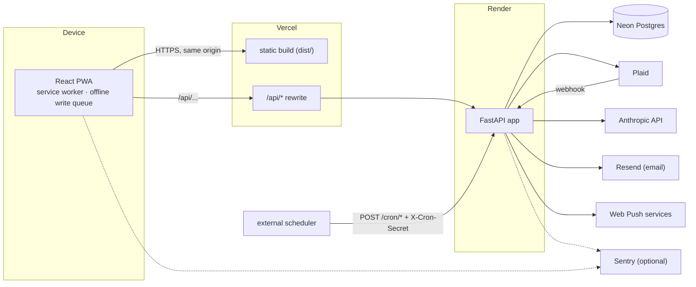
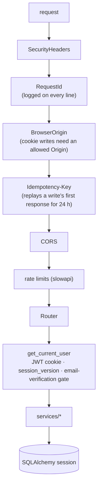
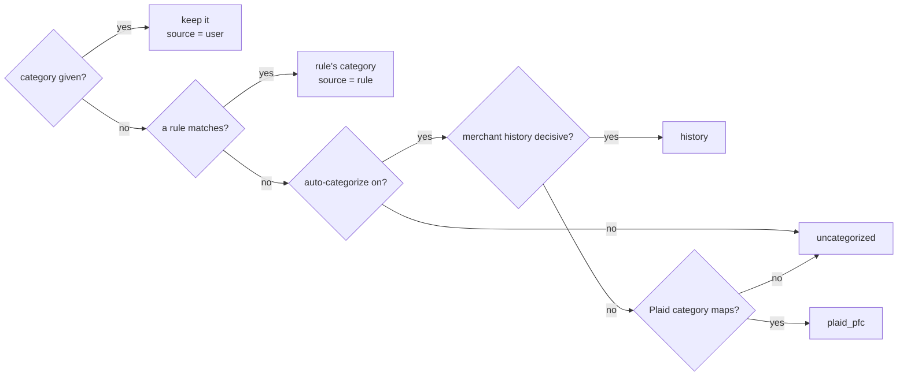
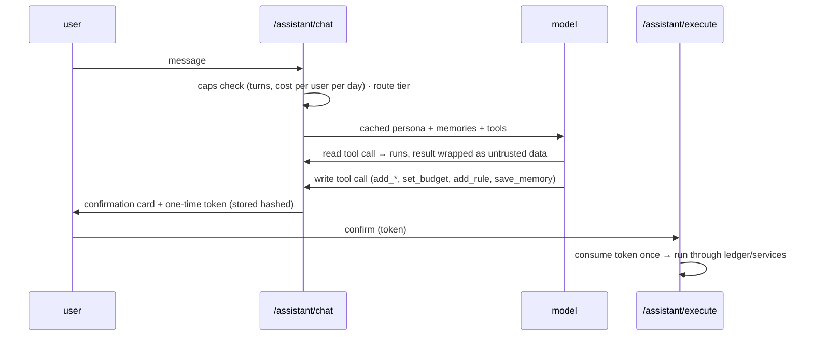
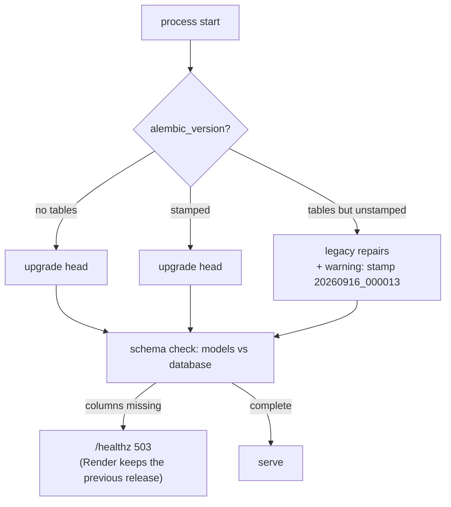

# Architecture

How Fintrack is put together, and the few invariants every change must keep.

## System context



The browser only ever talks to its own origin: Vercel serves the build and forwards `/api/*` to Render, so the session lives in HttpOnly cookies and there is no cross-site credential handling.

## Request path (backend)



- Every router scopes its queries to `current_user.id`; `tests/test_tenant_isolation.py` and `test_tenant_isolation_jobs.py` prove it route by route and for cron, jobs, push and assistant tools.
- Collection reads send ETags; the client caches and revalidates.
- The client queues writes offline and replays them with the same `Idempotency-Key`, so a retry cannot post twice.

## The ledger

Every transaction write goes through `LedgerService.stage_transaction`: manual entry, the assistant, recurring posting, savings spends and CSV import. It checks ownership, runs enrichment, and moves the balance with a SQL expression (`balance = balance + delta`), so concurrent writers never overwrite each other.

Category precedence, decided in one place (`services/transaction_enrichment.py`):



**Splits** (`services/splits.py`) never move money. Lines add up exactly to the parent, and the parent keeps the largest line's category. Budgets, the assistant's category totals and the analytics category views read the lines. An amount change, recategorizing the whole transaction, or a bank revision drops the split.

## Money definitions

Each figure has one definition on the server and, where the screens compute it too, one mirror in `frontend/src/features`. Tests pin the same cases on both sides.

| Figure | Server | Frontend mirror |
|---|---|---|
| What a transaction counts as (income, expense, refund, card payment, investment, **transfer**) | `services/classification.py` | `features/analytics/calculations/transactions.ts` |
| **Net worth** = account balances (cards negative, investment-type accounts left out) + holdings at current value | `services/net_worth.py` | `features/portfolio/calculations/wealth.ts` |
| A holding's current value: metal (weight × purity × metal price), market (ticker price × quantity), or recorded | `services/valuation.py` | the server's valuation is passed in (`GET /assets/valuations`) |
| Available to spend, emergency cash (goal money left out) | `services/cash_position.py` | `features/accounts/calculations/totals.ts` |
| Goal plan: goals funded in priority order, paycheck lines first | `services/goal_plan.py` | `features/portfolio/calculations/goalPlan.ts` |
| **One-offs**: spending of $1,000+ that does not repeat (or marked by the user), left out of the usual month | `services/one_offs.py` | `features/analytics/calculations/oneOffs.ts` |
| **Paychecks**: payers on a 1–5 week rhythm; typical pay = median of the last 90 days, same-day deposits summed | `services/paycheck_plan.py` (`suggest_sources`) | `features/analytics/calculations/paychecks.ts` |

- **Market prices** live in `market_prices`, one row per symbol (`stock:GLD`, `crypto:BTC`, `metal:XAU`), shared by every user. A reader serves the stored price and refreshes an old one in the background; a price never fetched is fetched inline. A failed lookup keeps the last good price. The assistant never waits on a provider (`refresh="never"`).
- **Net-worth history** (`/history/net-worth`): past months are each account's month-end balance plus every holding acquired by then at its recorded value; the current month is today's balances and today's valuation, never a stored snapshot.
- **Past balances** walk back from today's balance through `balance_movements()` (`services/balance_snapshots.py`): transactions plus transfers. On a bank-linked account the bank's own row wins, and a recorded transfer counts only when no transaction of the same amount sits within five days of it.
- **Transfers** between the user's own accounts are either rows in `transfers` or imported rows filed under a `transfer` category. Review suggests the second kind (`services/transfer_suggestions.py`); nothing is filed without a tap.
- **Net-worth history** starts at the month of the first transaction or transfer; earlier months would only repeat the opening balance. With no transactions or transfers at all, it is not trimmed.
- **Usual month**: the goal plan, the goal cards and the assistant fund goals from average monthly saving with one-offs added back; Analytics shows it beside the plain average. The emergency fund is measured in months of usual spending, and its deadline is ignored everywhere (`goalDeadline`).
- **Month-end outlook** (`forecast.ts`): income is what has landed, scheduled income, and paychecks still due at their typical size, with a range from the lowest to the highest recent paycheck. A stable monthly income fills the rest of the month only when no paycheck rhythm is found.
- **Missing bank rows** (`routers/plaid_router/missing.py`): a read-only `/transactions/sync` from the beginning finds transfer-like posted rows the ledger lacks; restoring re-fetches them and files them under Transfer without touching balances.
- **No database work on the event loop**: dependencies and routes that take a session are plain functions; async middleware hands its queries to the threadpool (`tests/test_event_loop_safety.py`).
- **Paycheck plan** (`services/paycheck_plan.py`): a payday is a date on which any chosen payer deposited. Its split is bills due before the next payday, a fixed line per goal, and what is free. Ticking a line can set its amount aside for the goal if the line's account holds that much unassigned.

## Bank sync

```mermaid
sequenceDiagram
  participant P as Plaid
  participant W as /plaid/webhook
  participant S as sync (background)
  participant DB as Postgres
  P->>W: SYNC_UPDATES_AVAILABLE
  W->>S: schedule sync(item)
  loop each page (cursor committed per page)
    S->>P: /transactions/sync
    S->>DB: added → enrich → INSERT … ON CONFLICT DO NOTHING (pending skipped)
    S->>DB: modified → update; amount revised ⇒ drop split lines
    S->>DB: removed → delete
  end
  S->>DB: reconcile recurring bills
  S->>DB: budget + low-balance checks (once per month / once per dip)
  S-->>P: (next page)
```

Sync health for each item (last source, counts, errors) is recorded and shown in Settings → Connections.

After a sync that imported anything, a paycheck from a paycheck-plan payer within the last six days sends one "Payday" push with the split, in place of the generic "Bank sync complete" push (`_notify_payday` in `routers/plaid_router/sync.py`).

## Assistant



The model never writes anything directly. Every change is a pending action that the person confirms.

## Sign-in

- A password alone creates the session (access and refresh JWTs in HttpOnly cookies, bound to `session_version`).
- If 2FA is on, the password returns a 5-minute challenge instead. `/auth/login/2fa` accepts a TOTP code or a recovery code.
- Failed passwords and failed codes each have a database-backed lockout.
- Enabling 2FA or resetting the password bumps `session_version`, which signs out every other session.

## Schema and boot



- Revisions are additive and guarded, so each one is correct on a database built by the chain and on one built from the models (production's history).
- CI builds the chain on Postgres and fails on any difference from the models (`scripts/check_schema_drift.py`).

## Frontend

- `src/pages/*` hold routes; everything except sign-in and the dashboard is lazy-loaded.
- `src/features/<area>/calculations` hold pure, unit-tested money logic with coverage floors in CI; components and hooks sit beside them.
- `src/utils/api.ts` is the only place that calls the backend. It adds idempotency keys, refreshes on 401 (never for sign-in attempts), and raises the verification gate.
- The service worker caches static assets, handles push, and shows a "new version" prompt with one reload on a stale chunk.
- Design tokens live in `src/index.css` and are documented in `DESIGN.md`. `e2e/a11y.spec.ts` enforces WCAG 2.2 AA on every page and sheet.
